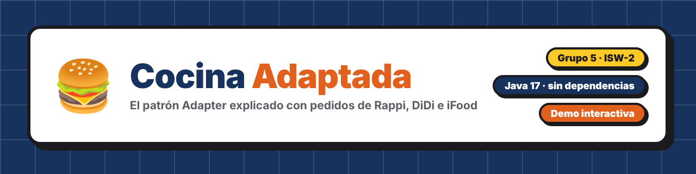
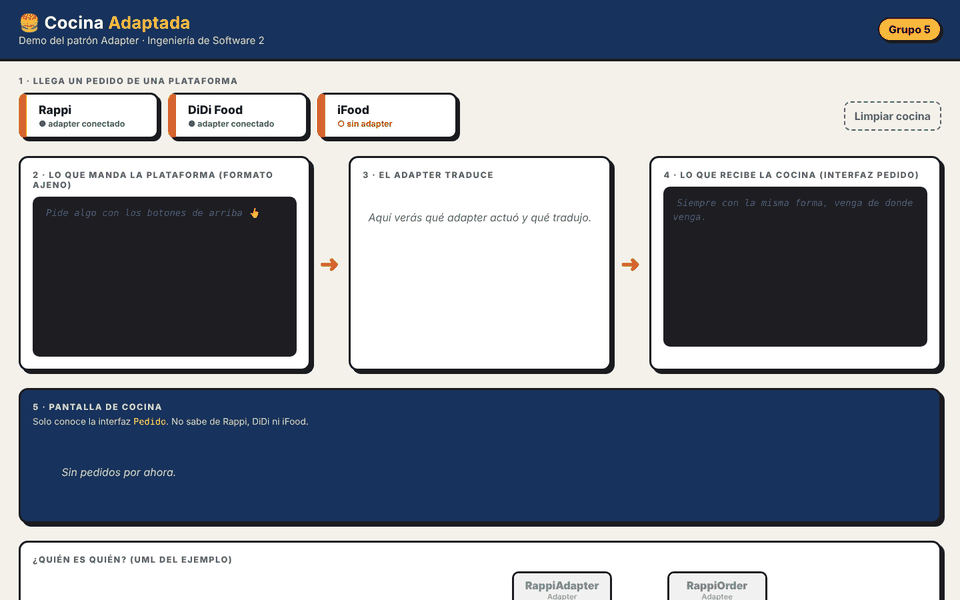
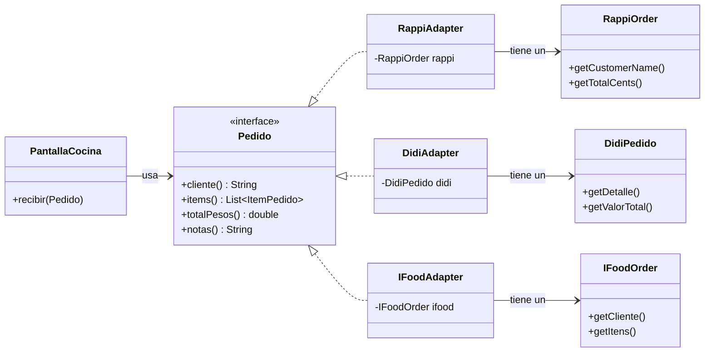
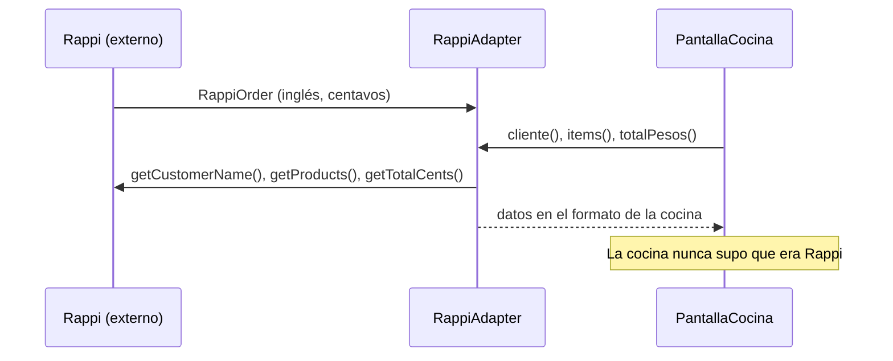
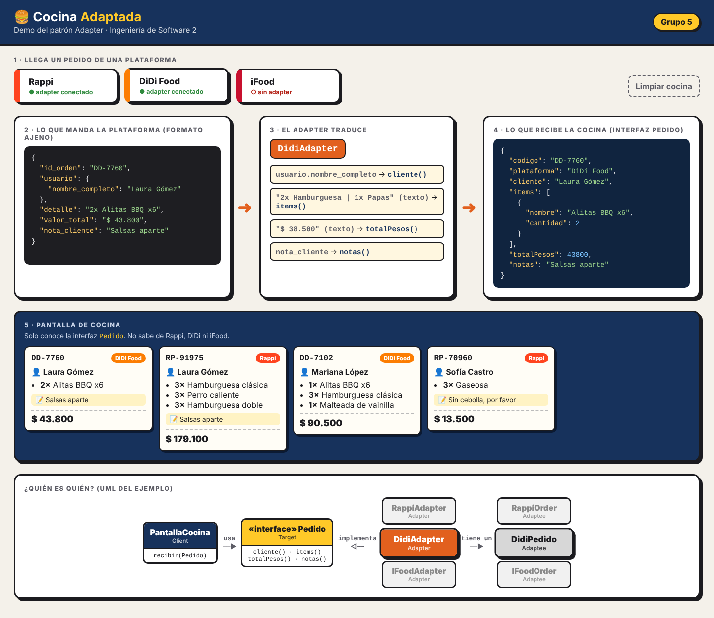
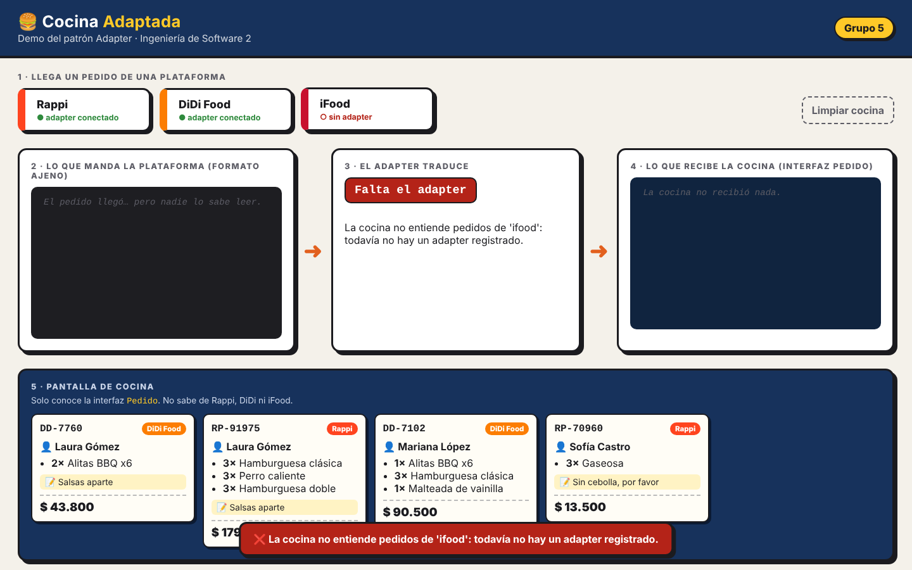

<p align="center">
  
</p>

<p align="center">
  <a href="https://github.com/Chocax/patron-adapter-grupo5/actions/workflows/build.yml"></a>
  
  
  
  
</p>

<p align="center">
  <b>Ejemplo práctico del patrón de diseño Adapter</b> para la exposición de Ingeniería de Software 2.<br>
  Juanita Mejía · Santiago Pinzón · Nicolás Espinosa · Hernando García
</p>

<p align="center">
  
</p>

---

## 📑 Contenido

- [El problema](#-el-problema)
- [La solución: las piezas del patrón](#-la-solución-las-piezas-del-patrón)
- [Guía de instalación y ejecución](#-guía-de-instalación-y-ejecución)
- [Solución de problemas](#-solución-de-problemas)
- [La prueba de fuego: conectar iFood en vivo](#-la-prueba-de-fuego-conectar-ifood-en-vivo)
- [Estructura del proyecto](#-estructura-del-proyecto)
- [Principios que se ven en el código](#-principios-que-se-ven-en-el-código)
- [Referencias](#-referencias)

## 🤔 El problema

Un restaurante de hamburguesas tiene una **pantalla de cocina** que muestra los pedidos a los cocineros. Esa pantalla solo entiende pedidos con un formato propio: cliente, platos, total en pesos y notas.

El restaurante recibe pedidos de **Rappi**, **DiDi Food** e **iFood**, y cada plataforma los manda a su manera:

| Lo que necesita la cocina | Rappi | DiDi Food | iFood |
|---|---|---|---|
| `cliente()` | `customerName` | `usuario.nombre_completo` | `cliente.nome` |
| `items()` | lista `products` | **un solo texto**: `"2x Hamburguesa \| 1x Papas"` | lista `itens` |
| `totalPesos()` | `totalCents` (en **centavos**) | **texto** `"$ 38.500"` | **no lo manda** (hay que sumarlo) |
| `notas()` | `userComments` | `nota_cliente` | `observacoes` |

No podemos modificar el código de Rappi, DiDi ni iFood porque son de terceros. Tampoco queremos llenar la cocina de `if (es Rappi) ... else if (es DiDi) ...`. En [`src/antes/PantallaCocinaAcoplada.java`](src/antes/PantallaCocinaAcoplada.java) está cómo se vería eso.

## 💡 La solución: las piezas del patrón

Un **Adapter** por plataforma. Cada uno traduce el pedido ajeno a la interfaz `Pedido` que la cocina ya entiende.

| Rol del patrón | Clase en este proyecto | Qué hace |
|---|---|---|
| **Client** | [`PantallaCocina`](src/cocina/PantallaCocina.java) | Lógica de negocio: recibe y muestra pedidos. Solo conoce `Pedido`. |
| **Target** | [`Pedido`](src/cocina/Pedido.java) (interfaz) | Lo que la cocina espera. |
| **Adaptee** | [`RappiOrder`](src/plataformas/rappi/RappiOrder.java), [`DidiPedido`](src/plataformas/didi/DidiPedido.java), [`IFoodOrder`](src/plataformas/ifood/IFoodOrder.java) | Los formatos de cada plataforma (simulan SDKs que no podemos tocar). |
| **Adapter** | [`RappiAdapter`](src/adaptadores/RappiAdapter.java), [`DidiAdapter`](src/adaptadores/DidiAdapter.java), [`IFoodAdapter`](src/adaptadores/IFoodAdapter.java) | `implements Pedido` y **tiene adentro** el pedido de la plataforma. Traduce y delega. |



Así se ve el adapter de Rappi:

```java
public class RappiAdapter implements Pedido {      // ES un Pedido
    private final RappiOrder rappi;                // TIENE un pedido de Rappi

    public String cliente()    { return rappi.getCustomerName(); }
    public double totalPesos() { return rappi.getTotalCents() / 100.0; }   // centavos -> pesos
    // ...
}
```

Y así viaja un pedido por el sistema:



## 🧰 Guía de instalación y ejecución

Solo necesitas **Java (JDK 17 o superior)**. No hace falta Maven, Gradle, base de datos ni librerías externas.

### Paso 1 · Instalar Java

> [!TIP]
> Si ya tienes Java, salta al paso 2. Para saberlo, abre una terminal y escribe `javac -version`. Si sale `javac 17` o un número mayor, ya estás listo.

Necesitas el **JDK** (kit de desarrollo), no solo el JRE, porque el proyecto se compila en tu máquina.

| Sistema | Cómo instalarlo |
|---|---|
| **Windows** | En PowerShell o CMD: `winget install EclipseAdoptium.Temurin.17.JDK`<br>O descarga el instalador `.msi` desde [adoptium.net](https://adoptium.net/temurin/releases/?version=17) y, durante la instalación, activa la opción **"Set JAVA_HOME"** / **"Add to PATH"**. |
| **macOS** | Con [Homebrew](https://brew.sh): `brew install --cask temurin@17`<br>O el instalador `.pkg` desde [adoptium.net](https://adoptium.net/temurin/releases/?version=17). |
| **Linux (Ubuntu/Debian)** | `sudo apt update && sudo apt install openjdk-17-jdk` |

Cierra y vuelve a abrir la terminal, y comprueba que quedó instalado:

```bash
java -version
javac -version
```

Ambos deben mostrar versión **17 o superior**.

### Paso 2 · Descargar el proyecto

**Opción A: sin Git (la más fácil).** Arriba en esta página, botón verde **`<> Code`** → **Download ZIP**. Descomprime el archivo donde quieras.

**Opción B: con Git.**

```bash
git clone https://github.com/Chocax/patron-adapter-grupo5.git
cd patron-adapter-grupo5
```

### Paso 3 · Ejecutar

Elige la forma que prefieras. Todas compilan el código y arrancan el servidor.

| Sistema | Comando |
|---|---|
| Windows | Doble clic en `run.bat` |
| Mac / Linux | `./run.sh` (si no tiene permisos: `chmod +x run.sh`) |
| A mano | `javac -encoding UTF-8 -d out $(find src -name "*.java")` y luego `java -cp out app.Main` |
| IDE | Abre la carpeta, marca `src` como código fuente y ejecuta `app.Main` |

Cuando todo va bien, la consola muestra:

```
==============================================
  Demo Patron Adapter - Cocina de domicilios
  Abre en el navegador:  http://localhost:14080
  Plataformas conectadas: [rappi, didi]
==============================================
```

### Paso 4 · Abrir la demo

Abre **http://localhost:14080** en el navegador y pide domicilios con los botones. Cada ticket también se imprime en la consola.

Para **detener** el programa, vuelve a la consola y presiona `Ctrl + C`.

<p align="center">
  
</p>

## 🎬 La prueba de fuego: conectar iFood en vivo

Al principio **iFood no está conectado**. Si le das clic, la cocina responde que no tiene adapter para leer ese pedido:

<p align="center">
  
</p>

Para conectarlo:

1. Abre [`src/app/Main.java`](src/app/Main.java).
2. Quita el `//` de esta línea:
   ```java
   // registrar("ifood", IFoodAPI::proximoPedido, IFoodAdapter::new, IFoodOrder::toJson);
   ```
3. Detén el programa (`Ctrl + C`) y vuelve a ejecutarlo.

iFood ya funciona, y **`PantallaCocina` no se tocó ni una línea**. Eso es el principio **Abierto/Cerrado**: el sistema queda abierto a nuevas plataformas y cerrado a modificaciones.

## 🩺 Solución de problemas

<details>
<summary><b><code>'javac' no se reconoce como un comando</code> / <code>javac: command not found</code></b></summary>

Java no está instalado o la terminal no lo encuentra.

1. Revisa el [paso 1](#paso-1--instalar-java) y asegúrate de instalar el **JDK**, no solo el JRE.
2. **Cierra y vuelve a abrir** la terminal después de instalar.
3. En Windows, si sigue fallando: busca *"Editar las variables de entorno del sistema"* → *Variables de entorno* → en `Path` agrega la carpeta `bin` del JDK (por ejemplo `C:\Program Files\Eclipse Adoptium\jdk-17...\bin`).
</details>

<details>
<summary><b><code>error: invalid source release</code> o errores con <code>record</code> / <code>switch</code></b></summary>

Tienes una versión de Java anterior a la 17. Ejecuta `javac -version`; si sale 8 u 11, instala el JDK 17 o superior (paso 1).
</details>

<details>
<summary><b><code>Address already in use</code> (el puerto 14080 está ocupado)</b></summary>

Ya hay otra copia del programa corriendo, probablemente en otra ventana de la terminal. Ciérrala o presiona `Ctrl + C` allí.

También puedes usar otro puerto con la variable `PORT`:

```bash
# Mac / Linux
PORT=15080 ./run.sh

# Windows (CMD)
set PORT=15080
run.bat
```

Y abre `http://localhost:15080`.
</details>

<details>
<summary><b>La página sale en blanco o con error 404</b></summary>

El programa no encuentra la carpeta `web/`. Ejecútalo **desde la carpeta raíz del proyecto** (donde están `run.bat` y `run.sh`). En el IDE, revisa que el *working directory* de la configuración de ejecución sea esa carpeta.
</details>

<details>
<summary><b><code>Permission denied</code> al ejecutar <code>./run.sh</code></b></summary>

Dale permisos de ejecución una sola vez:

```bash
chmod +x run.sh
```
</details>

<details>
<summary><b>Las tildes salen raras en la consola (<code>Sof?a</code>, <code>clásica</code>)</b></summary>

Es solo cómo la consola muestra los caracteres; la página web se ve bien. `run.bat` ya cambia la consola a UTF-8. Si lo ejecutas a mano en Windows, escribe antes `chcp 65001`.
</details>

## 📁 Estructura del proyecto

```
src/
├── cocina/          ← Nuestro dominio (Client + Target). No importa nada externo.
├── plataformas/     ← "SDKs" de terceros simulados (Adaptees). No se modifican.
│   ├── rappi/
│   ├── didi/
│   └── ifood/
├── adaptadores/     ← Los Adapters: la frontera entre lo nuestro y lo ajeno.
├── antes/           ← Cómo se vería SIN el patrón (código acoplado, solo para comparar).
└── app/             ← Servidor web y registro de plataformas.
web/
└── index.html       ← Página interactiva de la demo
.github/workflows/
└── build.yml        ← Compila y prueba los adapters en cada push
```

## 🧱 Principios que se ven en el código

- **Composición sobre herencia:** cada adapter *tiene* un pedido externo (`private final RappiOrder rappi`), no hereda de él.
- **Programar contra interfaces:** `PantallaCocina` solo usa `Pedido`, nunca un adapter concreto.
- **Responsabilidad única:** la traducción vive en los adapters; la cocina solo cocina.
- **Abierto/Cerrado:** agregar iFood = una clase nueva + una línea de registro.

## 📚 Referencias

- Freeman, E. & Robson, E. *Head First Design Patterns* (2.ª ed.), Cap. 7: Adapter y Facade.
- Refactoring.Guru: [Adapter](https://refactoring.guru/es/design-patterns/adapter)
- Gamma, Helm, Johnson & Vlissides. *Design Patterns* (GoF), 1994.

> [!NOTE]
> Los datos de Rappi, DiDi Food e iFood son simulados con fines educativos. Este proyecto no se conecta a ninguna API real.
